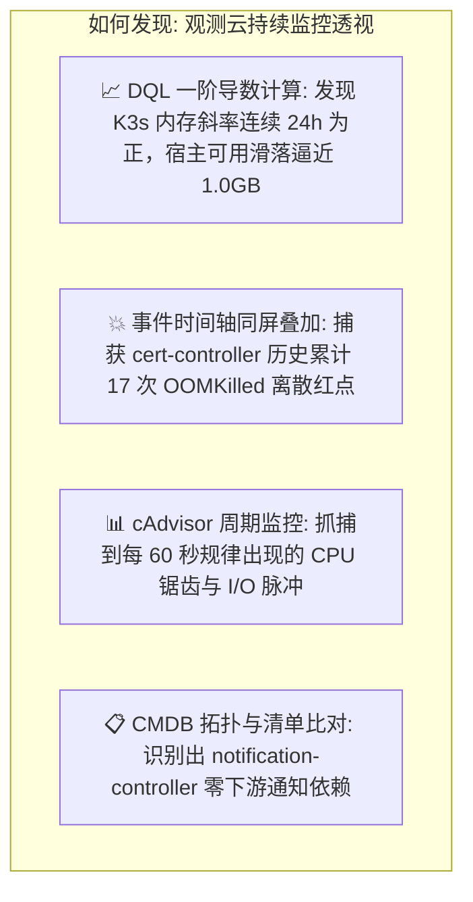
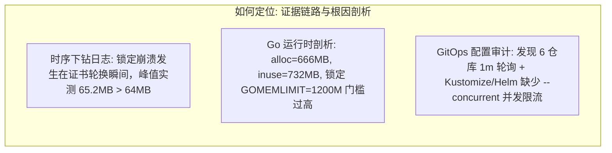
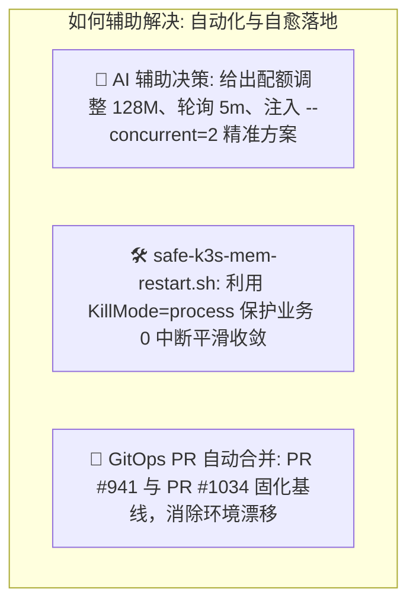
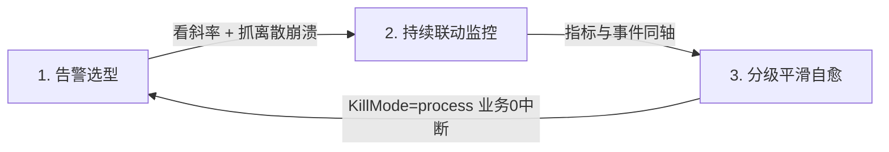

# 有些问题上线时根本看不到：独立开发者的 2C4G 极简云原生资源压榨与自愈实录

> 《独立开发观察者计划 - AI-SaaS 可观测 - 首季》第 4 期  
> 作者：Haitao Pan ｜ XWork Technologies LLC 服务支持 ｜ 许可：CC BY-SA 4.0  


---

## 引言：独立开发者的“2C4G 算力账本”

做独立开发或早期 AI-SaaS，成本控制是刻在骨子里的本能。我们大多数人的生产环境，起点往往是一台 2 vCPU、4 GiB 内存（实测可用 3.8 GiB，AMD EPYC 处理器）的海外轻量 VPS：上面跑着轻量 Kubernetes（K3s）、PostgreSQL 数据库、Vault 密钥管理、Traefik 网关、Flux CD 持续交付，外加一套承载核心业务的 AI-SaaS 容器。

每次代码提交、CI/CD 跑通、新版本滚动发布、探针返回熟悉的 `HTTP 200 OK`，屏幕前的你往往会长舒一口气：“一切正常，收工！”

但现实往往会在 72 小时后给你一记闷棍：
- **为什么没有任何高并发访问，宿主机的可用内存却每天悄悄蒸发 150 MiB？**
- **为什么凌晨没有任何用户调用，某个后台控制器突然被系统内核 OOMKilled 重启？**
- **为什么系统日志里隔几分钟就有一波 CPU 锯齿和磁盘 I/O 剧烈抖动？**

很多致命的资源损耗与稳定性隐患，**从来不是刚上线时一眼就能看出来的**。在资源宽裕的大厂环境，这些问题会被超配的硬件容量掩盖；但在 2C4G 的极限约束下，任何一个微小的资源毛刺，都会直接引发多米诺骨牌效应。

本文聚焦这一极具代表性的场景，复盘我们在真实生产节点（`prod-k3s-v6`，2C4G Debian 13 宿主机）上的资源攻坚实战：**面对上线看不到的四大隐形痛点，我们是如何发现的？如何精准定位的？又是如何借助观测云与智能工具辅助彻底解决的？**

---

## 一、痛点聚焦：四大“上线看不到”的隐形吞噬者

上线瞬间的单点测试，只能证明“功能可通”，却无法验证“时间维度上的资源熵增”。在 3.8 GiB 物理内存的狭窄空间里，四个隐形刺客正在默默蚕食系统的生命线：

```
+-----------------------------------------------------------------------------------+
|                        2C4G VPS 内存真实挤压现场 (3.8 GiB 物理上限)                |
+-----------------------------------------------------------------------------------+
| [K3s 控制面 968MB] ---> [PostgreSQL 550MB] ---> [Vault 152MB] ---> [containerd 191MB]
|                                                                                   |
|  ⚠️ 痛点 1: Go 堆未达 GOMEMLIMIT 阈值前，迟钝不 GC (堆积 9,951 Goroutines)        |
|  ⚠️ 痛点 2: cert-controller 稳态 45MB，轮换瞬时 65MB > 64MB 限制 -> 17次连续崩    |
|  ⚠️ 痛点 3: Flux 6 个 GitRepo 每 1m 轮询解包，双核 CPU 突发并发调谐抖动           |
|  ⚠️ 痛点 4: notification-controller 零通知依赖，常驻白吃 33MB RSS                 |
+-----------------------------------------------------------------------------------+
|  💥 结果：可用内存逼入 1.0 GiB 悬崖边缘，Swap 频繁吞吐，宿主机濒临内核冻结!         |
+-----------------------------------------------------------------------------------+
```

1. **Go Runtime 慢性堆膨胀**：K3s Server 聚合了控制面所有组件。原配置 `GOMEMLIMIT=1200MiB, GOGC=75`，导致 Go 运行时在堆未达 1.2GB 前迟钝不归还内存，常驻 RSS 膨胀至 **968 MiB**，协程堆积 **9,951 个**，单进程吃掉宿主机近 1/4 内存。
2. **微小突发临界 OOM**：`external-secrets-cert-controller` 平时仅占 45MB，被随手设了 `64Mi` 限制。一逢周期性证书轮换瞬间冲到 65MB，直接被系统内核 OOMKilled，连续**静默崩溃了 17 次**。
3. **GitOps 盲目高频空转**：6 个 `GitRepository` 设为 `1m` 轮询，每分钟拉取解包，双核 CPU 规律剧烈抖动；并发未受限导致突发调谐时内存瞬间脉冲。
4. **闲置组件吃空饷**：未配置外部通知的 `notification-controller` 孤悬后台，常年吃掉 **33 MiB** 物理内存。

---

## 二、如何发现？—— 突破“上线健康假象”的持续监控

为什么人肉看盘和传统健康检查根本发现不了这些问题？因为单点探针返回的永远是 `HTTP 200 OK`，瞬时 `top` 看到的也是风平浪静。

我们依靠**观测云（Guance Cloud）**的一体化持续可观测性穿透了盲区：



1. **算出一阶导数，发现慢性泄漏**：
   在观测云中利用 DQL 计算内存变化斜率：`M::k8s_pod:(derivative(memory_working_set_bytes, 1h)) { pod_name = "k3s-server" }`。系统连续 72 小时斜率持续为正，即便业务处于低谷，内存物理分页也未见有效归还，指示存在严重的堆滞留。
2. **事件时间轴叠加，发现隐蔽崩溃**：
   传统指标大盘往往因时序取样间隔把秒级崩溃抹平，但在观测云的容器大盘中开启 **「关联事件」**，时间轴上赫然标注出密密麻麻的鲜红圆点：`Reason: OOMKilled, ExitCode: 137`，精准抓出了白天根本看不到的 17 次静默崩溃。
3. **周期性脉冲捕捉，发现空转内耗**：
   在 CPU 时序监控中，清楚呈现出每隔整整 60 秒一次的整齐波峰，直接定位到高频轮询的调度节奏。

---

## 三、如何定位？—— 跨源穿透与代码级深度剖析

发现异常后，不能靠猜。我们通过观测云将指标、日志、事件打通，并展开代码态深度下钻：



1. **定位 17 次崩溃根因（64MiB 临界悬崖）**：
   - 鼠标点击观测云事件红点，右侧滑出崩溃发生时刻的日志上下文；
   - 发现内核 dmesg 杀进程日志与 `cert-controller` 生成 X.509 秘钥对的日志严格重合；
   - 查阅实时峰值 Working Set 恰好为 **65.2 MiB**，直接坐实因证书编解码短时缓冲冲破 64MiB 紧箍咒的根本原因。
2. **定位 K3s 进程膨胀根因（Go Runtime 惰性）**：
   - 采集 Go Runtime 深度指标：`go_memstats_alloc_bytes`（666MB）、`go_memstats_heap_inuse_bytes`（732MB）；
   - 对比 `/etc/systemd/system/k3s.service.env` 配置，发现 `GOMEMLIMIT=1200MiB, GOGC=75` 设置过宽。Go 运行时在 4G 小机型上以为自己内存充裕，从不积极触发物理内存归还（MADV_FREE），导致 Goroutines 堆积近万。
3. **定位 CPU 锯齿与并发根因（GitOps 抖动）**：
   - 检查 Flux 资源定义，发现 6 个 `GitRepository` 的 `interval` 均设为 `1m`；且 `kustomize-controller` 与 `helm-controller` 启动参数缺少并发限制，一旦多 Chart 触发同步，双核 CPU 瞬间挤爆。

---

## 四、如何辅助解决？—— 智能决策、零中断自愈与 GitOps 闭环

明确根因后，如何在不中断现有业务、不破坏生产稳定性的前提下彻底解决？我们构建了从智能建议、平滑自愈到 GitOps 沉淀的完整闭环：



### 1. 消除 64MiB 紧箍咒与 Flux CD 瘦身
- **配额调整**：将 `external-secrets-cert-controller` 的 Memory Limit 从 `64Mi` 上调至 `128Mi`。实测其稳定 Working Set 为 65MiB，留出近 50% 安全缓冲，**重启次数彻底归零**。
- **并发节流与轮询收敛**：
  - 为 `kustomize-controller` 与 `helm-controller` 注入 `--concurrent=2`，压制突发并发构建；
  - 将 6 个 `GitRepository` 轮询周期由 `1m` 收敛至 `5m`，**削减 80% 同步抖动与磁盘 tar 解包开销**。
- **清除僵尸组件**：将未绑任何接收器的 `notification-controller` 副本缩容为 0，移除 `--events-addr` 参数，**立省 33 MiB 常驻物理内存**。

### 2. K3s 控制面零中断平滑自愈（`safe-k3s-mem-restart.sh`）
对于单节点控制面膨胀，不能粗暴 kill。我们编写并交付了自愈脚本 `/usr/local/bin/safe-k3s-mem-restart.sh`：
- **核心秘密**：严格确保 systemd 单元配置了 `KillMode=process`。这意味着当重启 `k3s server` 进程时，宿主机上正在运行的 `containerd-shim` 和所有业务 Pod **坚决不被杀掉**，网络转发与对外服务全程不中断！
- **平滑自愈流程**：
  1. 自动执行 etcd/sqlite 权威数据快照备份；
  2. 重启 K3s 控制平面；
  3. 轮询 `/readyz` 就绪探针（API Server 在 13 秒内安全恢复）；
  4. 配合环境文件固化参数：`GOMEMLIMIT=768MiB`、`GOGC=50`，激进化垃圾回收。

### 3. 实测战报：生产节点指标对比表

在 `prod-k3s-v6` 真实节点完成优化后的实测数据如下：

| 优化维度 | 优化前指标（Baseline） | 优化后指标（Optimized） | 收益与成效 |
| :--- | :--- | :--- | :--- |
| **K3s Server RSS** | **955 MiB**（976,208 kB） | **601 MiB**（稳态约 800 MiB） | **净释放 354 MiB 物理内存** |
| **K3s Goroutines** | **9,951** | **4,564** | **并发协程数下降 54%** |
| **宿主机 Mem Available** | 1.0 GiB（Free: 383 MiB） | **1.25 GiB**（Free: 540 MiB） | **宿主机安全可用空间提升 25%** |
| **CertController 稳定性** | 历史累计 17 次 OOM 崩溃 | **连续运行 0 次重启**（Limit 128M） | **彻底消除临界 OOMKilled** |
| **Flux CD 常驻内存** | 约 160 MiB | **约 125 MiB**（停用 notification） | **削减 33 MiB，消除构建突发 CPU 尖刺** |
| **业务容器状态** | 潜在抖动风险 | **11 个 Kustomization / 8 个 Helm 全部 100% Ready** | **平滑自愈，业务 0 中断** |

---

## 五、避坑经验：以后再遇到这类问题，告警与监控怎么选？

这场攻坚战打完，我们沉淀了一套专属于 2C4G 小机型的云原生告警黄金法则：



### 1. 抛弃“静态 80%”，盯紧三条黄金法则
在 4G 小机型上，Linux 内核会尽量利用空闲内存做 PageCache，内存使用率常年趴在 70%–80% 是完全健康的常态。盲目配 `Memory > 80%` 会导致严重的告警疲劳；而配成 `90%` 时，收到告警时系统往往已内核死锁。

**推荐配置的三类智能告警：**
1. **看斜率（趋势预测）**：通过观测云 DQL `predict_linear` 预测容器内存是否将在未来 2 小时内耗尽 Limit，提前拦截慢泄漏；
2. **抓离散（OOM 捕获）**：监控 `k8s_event` 中 `Reason == "OOMKilled"`，发生一次即报警，不让隐蔽崩溃溜走；
3. **看可用（安全余量）**：只监控真实可调度的 `MemAvailable / MemTotal < 0.12`，过滤掉无害的 Cache/Buffer 干扰。

### 2. 自动恢复（自愈）必须分级推进
- **Level 1（运行时内部防线）**：配置 `GOMEMLIMIT=768MiB` 与 `GOGC=50`，让 Go 运行时在触及软上限前主动频密 GC；
- **Level 2（控制面平滑自愈）**：将 `safe-k3s-mem-restart.sh` 与观测云 Webhook 联动，在内存持续超标时安全重启 API Server，13 秒内完成垃圾回收，宿主机业务 Pod 全程不掉线；
- **Level 3（配置基线 GitOps 沉淀）**：所有调优参数必须以 PR 形式合入 GitOps 仓库，确保生产现场与代码版本永久一致。

---

## 结语：极致资源的背后，是确定性的工程美学

独立开发者没有大厂无限挥霍的算力预算。但小机器并不意味着脆弱，也不意味着运维只能靠运气和半夜爬起来重启。

**“有些问题上线时看不到”不是借口，而是提醒我们：把视线从“单次部署”拉长到“生命周期”。** 借助观测云轻量一体化的 DataKit 采集、指标与事件的同轴关联、以及智能预测告警，我们在 2C4G 的微型主机上同样能建立起坚不可摧的高可用防线。在有限预算下把资源压榨到极致，并给系统注入自动化自愈的底牌——这正是专属于独立开发者的高效、从容与极简云原生工程美学。

---

### 附录：工程依据与代码版本

本文记录的全部优化与自愈实践均在生产节点落地，并合入标准化工程仓库：

- **GitOps 配置仓库**：
  - PR #941：[gitops-canary-samples](https://github.com/ai-workspace-infra/gitops-canary-samples)（External Secrets 内存配额提升至 128M、Flux 控制器 `--concurrent=2` 限流与 5m 轮询收敛）
- **Playbooks 自动化运维仓库**：
  - PR #1034：[ai-workspace-infra/playbooks](https://github.com/ai-workspace-infra/playbooks/pull/1034)（标准脚本 `safe-k3s-mem-restart.sh`、`GOMEMLIMIT=768MiB` 模板固化与 SQLite 轻量化 Profile 交付）
- **知识库白皮书**：
  - [PROD-K3S-V6 内存优化基线规范](https://github.com/ai-workspace-services/knowledge/blob/main/docs/reference/platform-delivery/clusters/prod-k3s-v6/)

*(注：关于如何使用 Chaos Mesh 模拟上述故障、以及构建完整的 GitOps 流水线演练，我们将在后续进阶专题中专门展开探讨。)*

---
Haitao Pan ｜ XWork Technologies LLC 服务支持 ｜ 欢迎在评论区交流你的 2C4G 云原生资源压榨技巧！
